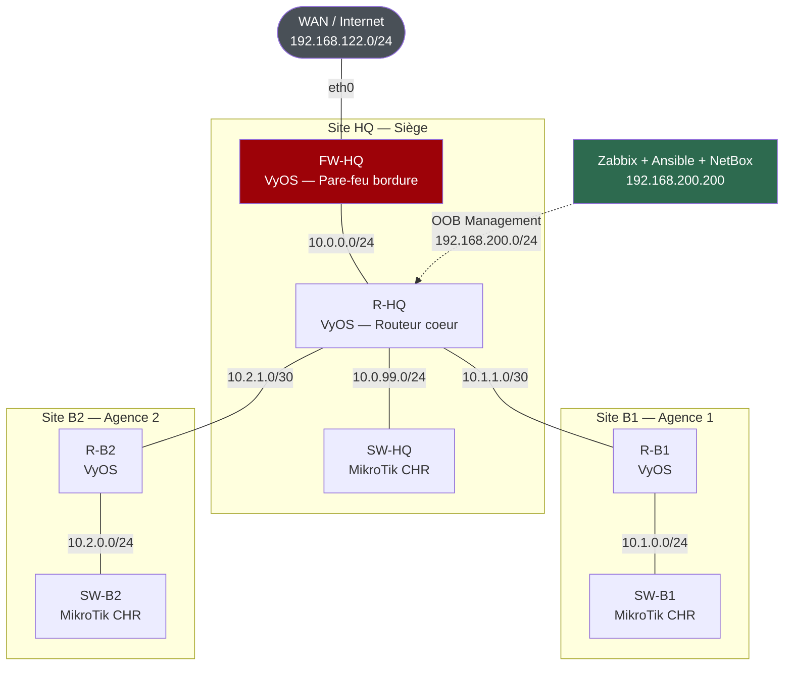

# NOC Lab — Infrastructure Multi-Site, Supervision & Automatisation

Laboratoire NOC (Network Operations Center) construit de bout en bout comme projet portfolio :
conception d'une infrastructure réseau multi-sites, déploiement d'une supervision centralisée,
simulation et résolution d'incidents réels, puis industrialisation via automatisation et
documentation d'infrastructure.

> Projet personnel réalisé sur matériel unique (ThinkPad T440p, 16 Go RAM) avec virtualisation
> imbriquée — l'intégralité de l'infrastructure est reproductible sans matériel réseau physique.

---

## Sommaire

- [Architecture](#architecture)
- [Plan d'adressage](#plan-dadressage)
- [Stack technique](#stack-technique)
- [Phases du projet](#phases-du-projet)
- [Modules d'industrialisation](#modules-dindustrialisation)
- [Compétences démontrées](#compétences-démontrées)
- [Structure du dépôt](#structure-du-dépôt)

---

## Architecture

Trois sites interconnectés en OSPF, un pare-feu de bordure vers le WAN, et un **réseau de
management out-of-band dédié** qui permet à la supervision d'atteindre tous les équipements
indépendamment de l'état du lien WAN.



**Principe clé :** le serveur de supervision n'atteint pas le lab par le chemin de production.
Il dispose d'une interface dédiée sur un segment isolé (`192.168.200.0/24`) raccordée directement
au routeur cœur — garantissant que la supervision reste opérationnelle même quand le lien WAN
qu'elle surveille tombe.

---

## Plan d'adressage

| Préfixe | Rôle | Site | Détail |
|---|---|---|---|
| `192.168.122.0/24` | WAN | HQ | Simulation Internet (réseau NAT libvirt) |
| `192.168.200.0/24` | OOB Management | HQ | Réseau isolé de supervision (`forward mode='none'`) |
| `10.0.0.0/24` | LAN | HQ | FW-HQ (`.1`) ↔ R-HQ (`.254`) |
| `10.0.99.0/24` | LAN | HQ | R-HQ (`.1`) ↔ SW-HQ (`.2`) |
| `10.1.1.0/30` | Interconnexion | B1 | R-HQ (`.1`) ↔ R-B1 (`.2`) |
| `10.1.0.0/24` | LAN | B1 | R-B1 (`.1`) ↔ SW-B1 (`.2`) |
| `10.2.1.0/30` | Interconnexion | B2 | R-HQ (`.1`) ↔ R-B2 (`.2`) |
| `10.2.0.0/24` | LAN | B2 | R-B2 (`.1`) ↔ SW-B2 (`.2`) |

Routage dynamique **OSPF single-area** (`area 0.0.0.0`), avec annonce du préfixe de management
en mode `passive-interface` pour éviter toute adjacence accidentelle sur le segment OOB.

---

## Stack technique

| Domaine | Outils et versions |
|---|---|
| Hyperviseur | KVM / libvirt / `virsh` — Ubuntu 24.04 LTS |
| Émulation réseau | EVE-NG Community Edition 6.2 (virtualisation imbriquée) |
| Routage / Pare-feu | VyOS Rolling 2026.10 — OSPF, firewall stateful, QoS `network-emulator` |
| Switching | MikroTik RouterOS CHR 7.23 |
| Supervision | Zabbix 6.4.21 — SNMPv3, ICMP, LLD, triggers, dashboards |
| Base de données | MySQL (backend Zabbix), PostgreSQL (backend NetBox) |
| Alerting | Telegram — media type webhook, macros `{ALERT.SENDTO}` |
| Automatisation | Ansible 2.16 — collections `vyos.vyos`, `community.routeros` |
| Gestion des secrets | Ansible Vault (AES256) |
| IPAM / DCIM | NetBox — déploiement Docker Compose (`netbox-docker`) |
| Conteneurisation | Docker / Docker Compose |

---

## Phases du projet

### Phase 1 — Infrastructure de virtualisation

Mise en place du socle permettant de faire tourner un lab réseau complet sur une seule machine.

- Installation et configuration de l'hyperviseur **KVM/libvirt** sur Ubuntu 24.04
- Déploiement d'**EVE-NG Community Edition** en machine virtuelle avec **virtualisation imbriquée**
  activée (prérequis pour faire tourner VyOS et RouterOS CHR à l'intérieur)
- Configuration des réseaux virtuels libvirt et des ponts (`virbr0` pour le WAN simulé)
- Déploiement d'une VM Ubuntu 24.04 dédiée à la supervision (`192.168.122.200`), provisionnée
  via **cloud-init / autoinstall**

### Phase 2 — Construction de la topologie réseau

- Conception de l'architecture multi-sites et définition du plan d'adressage (voir tableau ci-dessus)
- Déploiement des **7 équipements** dans EVE-NG : 4 routeurs VyOS (dont FW-HQ en pare-feu de
  bordure) et 3 switches MikroTik CHR
- Interconnexions point-à-point en `/30` entre routeurs, LAN en `/24` par site
- Configuration **OSPF** (`area 0.0.0.0`) et établissement des adjacences entre les trois sites
- Mise en place des règles de **pare-feu stateful** sur FW-HQ (politique par défaut `drop`,
  autorisation du trafic `established/related`, ouverture ciblée des flux de supervision)

### Phase 3 — Validation réseau de bout en bout

- Vérification de la connectivité inter-sites (ping, traceroute) et des tables de routage OSPF
- Contrôle de la propagation des routes et de la cohérence des next-hops
- Tests de la politique de pare-feu (flux autorisés vs bloqués)
- Configuration **SNMP** sur les 7 nœuds (community `NOC-LAB`, accès lecture seule)
- Mise en place du chemin réseau hôte → lab, rendu **persistant** (route libvirt + netplan)
- Application du principe de **moindre privilège** : règles pare-feu restreintes à la seule
  adresse du serveur de supervision

### Phase 4 — Déploiement de la supervision Zabbix

- Installation de **Zabbix Server 6.4** + MySQL + frontend Apache sur la VM dédiée
- Création des **7 hosts** avec interface SNMP, templates `Network Generic Device by SNMP`
  et macro `{$SNMP_COMMUNITY}`
- Mise en place de triggers métier : pertes ICMP, états d'interface, disponibilité des agents SNMP
- Construction de dashboards : *Problems by severity*, *Host availability*, graphes de débit
- Validation SNMP de bout en bout depuis le serveur de supervision

**Difficulté résolue — résolution des OID :** l'erreur `Unknown Object Identifier` lors des
`snmpwalk` n'était pas un problème réseau mais l'absence des fichiers MIB côté client. Zabbix
embarquant ses propres définitions, seul l'outil CLI était impacté. Leçon retenue : distinguer
une erreur d'outil d'une erreur d'infrastructure avant d'escalader le diagnostic.

### Phase 5 — Simulation et résolution d'incidents

Trois incidents provoqués volontairement, diagnostiqués et documentés comme en production.

#### Incident 1 — Panne du lien WAN sur le pare-feu de bordure

Désactivation d'`eth0` sur FW-HQ. **Résultat inattendu :** Zabbix bascule l'hôte entier en
*Unreachable* au lieu de signaler précisément l'interface WAN en panne.

**Cause racine :** le chemin de retour du trafic de supervision dépendait du lien WAN lui-même —
la supervision était donc victime de la panne qu'elle devait signaler. Cet incident a directement
motivé la refonte architecturale du [Module 2 (OOB)](#module-2--réseau-de-management-out-of-band).

#### Incident 2 — Perte d'un routeur distant et reconvergence OSPF

Arrêt brutal de R-B1. Mesure du délai réel de bascule de disponibilité dans Zabbix : **40 à 60
minutes** avec la configuration par défaut — inacceptable pour un NOC.

**Diagnostic** multi-couches (processus `zabbix_server`, requêtes SQL sur les tables `interface`
et `item_rtdata`, analyse de la file d'attente des pollers) : avec `Timeout=4` et un seul
`unreachable poller`, le balayage des 77 items SNMP de l'hôte prenait plusieurs minutes par cycle.

**Correctif appliqué** dans `zabbix_server.conf` :

| Paramètre | Avant | Après |
|---|---|---|
| `Timeout` | 4 | 2 |
| `StartPollersUnreachable` | 1 | 3 |
| `UnreachablePeriod` | 45 | 30 |
| `UnreachableDelay` | 15 | 10 |
| `UnavailableDelay` | 60 | 30 |

Temps de détection ramené à moins d'une minute.

#### Incident 3 — Dégradation de lien (latence injectée)

Injection de **300 ms de latence** sur le lien R-HQ ↔ R-B2 via la policy VyOS
`qos network-emulator` (netem noyau Linux), vérifiée avec `tc qdisc show`.

**Résultat clé :** le trigger de latence moyenne (`avg(/R-B2/icmppingsec,5m)`) se déclenche
correctement, **tandis que l'hôte reste "Available" tout du long**. C'est exactement le
comportement attendu d'une supervision bien calibrée : détecter une dégradation de qualité
de service sans déclarer l'équipement en panne.

#### Enseignements de la phase 5

1. **La latence de détection est asymétrique** selon le type de check (ICMP vs SNMP) — un trigger
   correct ne suffit pas, le dimensionnement des pollers conditionne le délai réel de détection.
2. **La bascule up/down n'est pas symétrique** par conception dans Zabbix.
3. **Un état transitoire ne se diagnostique pas a posteriori** : les colonnes `available` et
   `errors_from` décrivent l'instant présent, pas l'historique.
4. **Lire le message d'erreur littéralement avant d'escalader** : une confusion de syntaxe
   (`ping <cible> count <n>` en VyOS vs `ping -c <n> <cible>` en Linux) a coûté une heure de
   diagnostic réseau inutile alors que le message d'erreur nommait précisément le problème.

---

## Modules d'industrialisation

### Module 1 — Alerting Telegram

Media type webhook Zabbix connecté à un bot Telegram. Utilisation de la macro `{ALERT.SENDTO}`
plutôt qu'un Chat ID codé en dur, permettant une diffusion par destinataire via la configuration
*Media* de chaque utilisateur Zabbix.

Validé en conditions réelles : réception des notifications de problème **et** de résolution.

### Module 2 — Réseau de management Out-of-Band

Réponse architecturale directe à l'Incident 1.

**Mise en œuvre :**
- Réseau libvirt isolé (`virbr-mgmt`, `forward mode='none'`, aucune route vers Internet)
- Interface dédiée sur la VM de supervision (`enp7s0` — `192.168.200.200/24`), persistée via netplan
- Nouvelle interface `eth4` sur R-HQ (`192.168.200.1/24`), seul point de contact entre la
  supervision et le lab
- Annonce du préfixe en OSPF avec `passive-interface` pour que les routeurs distants sachent
  répondre, sans jamais former d'adjacence sur le segment de management
- Route de retour statique sur FW-HQ, topologie EVE-NG mise à jour avec le cloud `OOB-MGMT`

**Durcissement sécurité :** une fois le nouveau chemin validé, les règles de pare-feu WAN
historiques ont été supprimées et les communautés SNMP restreintes au seul préfixe OOB.

**Validation — Incident 1 rejoué :** coupure d'`eth0` sur FW-HQ.
Résultat : `7 Available / 0 Not available`, un seul problème actif
(`FW-HQ: WAN interface down - CRITICAL`). La supervision ne dépend plus de ce qu'elle surveille.

### Module 3 — Migration SNMPv2c → SNMPv3

Passage des 7 équipements de SNMPv2c (community string en clair) à **SNMPv3 niveau `authPriv`**
(authentification SHA + chiffrement AES).

**Spécificités par constructeur :**
- *VyOS* — ordre de configuration imposé : `engineid` → `view` → `group` → `user` ;
  les noms d'objets SNMPv3 n'acceptent pas les tirets
- *MikroTik* — tout se configure sous `/snmp community` ; le mot de passe doit être défini
  **avant** l'activation de `security=private`, et les valeurs de protocole sont sensibles à la
  casse (`SHA`/`AES`, pas `sha`/`aes`)

**Stratégie de migration sans coupure**, appliquée équipement par équipement :
configurer → valider en `snmpwalk -v3` → basculer la fiche Zabbix → confirmer la disponibilité →
seulement ensuite désactiver SNMPv2c. Résultat final : plus aucun SNMP en clair sur le lab.

**Incident subtil résolu — engine-id dupliqué :** SW-HQ restait en timeout côté Zabbix alors
qu'un `snmpwalk` manuel répondait en moins de 200 ms. Ni mot de passe, ni réseau, ni `SourceIP`
en cause. Diagnostic : SW-HQ et SW-B1 partageaient le **même `engine-id`**, hérité du clonage
des VM CHR depuis une image de base commune. En SNMPv3/USM, l'engine-id est l'identité
cryptographique servant à la synchronisation temporelle — un doublon fait entrer en conflit le
cache d'état USM de Zabbix, produisant des timeouts invisibles en test manuel (chaque `snmpwalk`
isolé refaisant une découverte fraîche). Correctif : `engine-id-suffix` unique par équipement.

### Module 4 — Automatisation Ansible

Nœud de contrôle hébergé sur la VM de supervision (déjà raccordée à l'OOB).
Inventaire séparé par constructeur, connexion SSH `network_cli` via `paramiko`.

**Playbooks produits :**

| Playbook | Rôle |
|---|---|
| `backup_configs.yml` | Sauvegarde horodatée de la configuration complète des 7 équipements |
| `rotate_snmpv3.yml` | Rotation des identifiants SNMPv3, identique sur tout le parc en une exécution |

Le second playbook rejoue délibérément une opération qui, faite manuellement, avait produit des
incohérences entre équipements (mots de passe divergents, pannes de supervision silencieuses) —
démontrant concrètement l'apport de l'automatisation sur la cohérence de configuration.

**Incidents de mise en route résolus :**
- SSH jamais activé sur les routeurs VyOS (pilotés jusque-là par console EVE-NG)
- Vérification de clé d'hôte bloquant la première connexion → `ansible.cfg` dédié
- Timeout de `commit` VyOS (30 s insuffisants sous la charge du lab) → `ansible_command_timeout: 90`
- **Cache SNMPv3 Zabbix périmé après `commit`** : chaque commit Ansible redémarre le démon SNMP
  du routeur et incrémente son compteur *engine boots*. Zabbix conservait l'ancienne valeur en
  cache et rejetait les réponses avec un message trompeur `Authentication failure`, alors que
  les identifiants étaient corrects des deux côtés. Résolu par redémarrage du service
  `zabbix-server`, forçant une redécouverte propre.

**Sécurisation des secrets :** mots de passe SSH et identifiants SNMPv3 chiffrés avec
**Ansible Vault** (AES256) dans `group_vars/*/vault.yml`, référencés par variables
`{{ vault_... }}`. Aucun secret en clair sur disque ; exécution via `--ask-vault-pass`.

### Module 5 — NetBox (IPAM / DCIM)

Déploiement conteneurisé via `netbox-docker` (NetBox + PostgreSQL + Redis + Nginx) sur la VM
de supervision.

**Modélisation réalisée :**
- 1 région (`NOC-LAB`), 3 sites (HQ, B1, B2)
- 2 fabricants, 2 modèles d'équipement, 3 rôles (Router, Firewall, Switch)
- 7 instances d'équipement avec leurs interfaces et adresses IP assignées
- 9 préfixes avec rôles fonctionnels (LAN, WAN, OOB-Management, Interconnexion)
- Token API généré en vue d'une intégration **inventaire dynamique Ansible ↔ NetBox**

NetBox reconstitue automatiquement la relation préfixe ↔ adresses IP et affiche les taux
d'occupation par sous-réseau — ce qu'un tableur ne permet pas de maintenir de façon fiable.

---

## Compétences démontrées

**Réseau et sécurité**
- Routage dynamique OSPF, interconnexions point-à-point, conception de plan d'adressage
- Pare-feu stateful VyOS, politique de moindre privilège, durcissement progressif
- QoS et injection de dégradation contrôlée (`tc netem`) pour test de supervision
- Conception d'un réseau de management out-of-band isolé

**Supervision**
- Zabbix 6.4 : templates, découverte de bas niveau (LLD), triggers custom, macros, dashboards
- SNMPv3 (SHA/AES) de bout en bout sur matériel hétérogène
- Dimensionnement des pollers pour atteindre un objectif de délai de détection
- Alerting multi-canal avec routage par destinataire

**Automatisation et DevOps**
- Playbooks Ansible avec collections vendor-spécifiques (VyOS, RouterOS)
- Gestion de secrets avec Ansible Vault
- Déploiement conteneurisé (Docker Compose)
- Versioning Git

**Méthodologie de diagnostic**
- Lecture littérale des messages d'erreur avant escalade de diagnostic
- Distinction systématique symptôme / cause racine
  (ex. : `Authentication failure` révélant en réalité un cache applicatif périmé)
- Validation du nouveau chemin avant suppression de l'ancien, sur chaque migration
- Documentation vivante des incidents comme capitalisation d'expérience

---

## Structure du dépôt

```
noc-lab-portfolio/
├── README.md
├── docs/
│   ├── architecture/        # Schémas de topologie
│   ├── incidents.md         # Rapports d'incident détaillés
│   ├── runbook.md           # Procédures opérationnelles
│   └── screenshots/         # Captures Zabbix, NetBox, Telegram
├── ansible/
│   ├── ansible.cfg
│   ├── inventory.yml
│   ├── group_vars/          # Secrets chiffrés (Ansible Vault)
│   └── playbooks/
│       ├── backup_configs.yml
│       └── rotate_snmpv3.yml
├── configs/
│   ├── vyos/                # Sauvegardes de configuration
│   └── mikrotik/
└── netbox/
    └── README.md            # Procédure de déploiement
```

---

## Auteur

**Amyra Zouabi** — Profil réseau orienté administration et supervision NOC

- LinkedIn : *(à compléter)*
- Email : zouabiamira422@gmail.com
